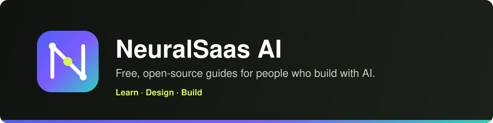

  

  Free, open-source guides to <strong>AI engineering</strong>, <strong>AI system design</strong> and <strong>vibe coding</strong>. 
  Learn LLMs, AI agents, RAG and evals, practise for AI system design interviews, and choose the right AI coding tools. 
  Everything here is free to read, and contributions are welcome.

<table>
  <tr>
    <td width="33%" align="center" valign="top">
      
      <h3>AI Engineering Playbook</h3>
      
<strong>Learn the skills.</strong> LLMs, agents, guardrails, LLM security, evals and memory, with hands-on projects. Beginner to intermediate.

      
      
    </td>
    <td width="33%" align="center" valign="top">
      
      <h3>AI System Design Playbook</h3>
      
<strong>Apply them.</strong> 20 case studies of real AI systems, covering architecture, scale, cost and failure modes. Good for interview prep.

      
      
    </td>
    <td width="33%" align="center" valign="top">
      
      <h3>Vibe Coding Hub</h3>
      
<strong>Build with AI tools.</strong> Tools, free tiers, current prices, and how to keep an AI-built app running.

      
      
    </td>
  </tr>
</table>

### Where to start

| You are... | Start here |
|---|---|
| New to AI engineering | [AI Engineering Playbook](https://github.com/NeuralSaasAi/ai-engineering-playbook), then the [AI System Design Playbook](https://github.com/NeuralSaasAi/ai-system-design-playbook) |
| Preparing for an AI system design interview | [AI System Design Playbook](https://github.com/NeuralSaasAi/ai-system-design-playbook) |
| Building an app with AI tools, not an engineer | [Vibe Coding Hub](https://github.com/NeuralSaasAi/vibe-coding-hub) |

Found a mistake or want to add something? Open an issue or a pull request in any repo.

  

